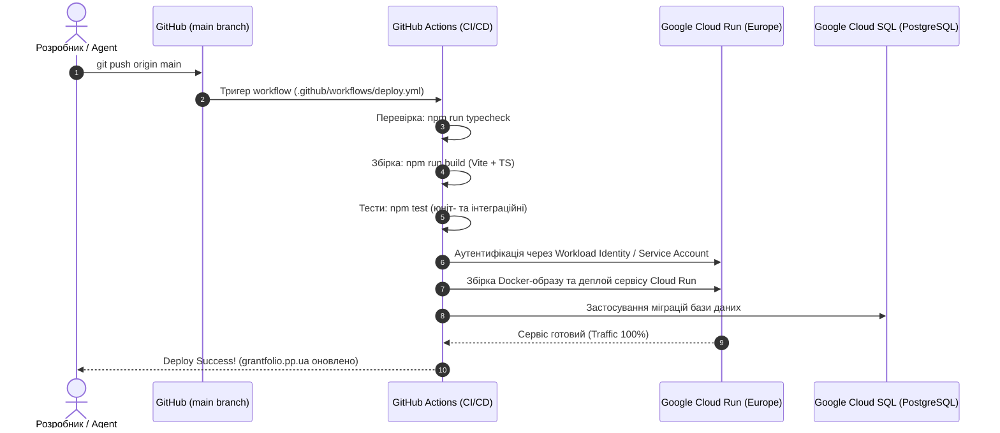

# Архітектурний звіт системи GrantFolio: Як усе працює

> **Дата складання:** 18 листопада 2026 року  
> **Призначення:** Повний технічний огляд архітектури, потоків даних, компонентів та інфраструктури вебзастосунку GrantFolio для фінальної демонстрації та експлуатації.  
> **Production URL:** [https://grantfolio.pp.ua](https://grantfolio.pp.ua)  
> **Репозиторій:** [https://github.com/stashnid/GrantFolio](https://github.com/stashnid/GrantFolio)

---

## 1. Загальний огляд системи

**GrantFolio** — це сучасний вебзастосунок для малого та середнього бізнесу, ветеранів і підприємців-початківців в Україні. Застосунок автоматизує шлях від сирої бізнес-ідеї до готового пакету документів і чернетки грантової заявки (пілотна програма — державна підтримка «Власна справа», ветеранські гранти та суміжні конкурси).

### Ключові технологічні підвалини
* **Клієнт (Frontend):** React 19, TypeScript, Vite, власна дизайн-система на базі шрифту Manrope, адаптивна мобільна верстка без зайвих важких UI-бібліотек.
* **Сервер (Backend):** Node.js 24 LTS, Express 5, модульний моноліт, типізована валідація вхідних даних (Zod).
* **База даних:** Керована PostgreSQL (Google Cloud SQL), пул підключень `pg`, транзакційне збереження версій і кошторисів.
* **Штучний інтелект:** Google Gemini (Gemini 2.5/3.5 Flash-Lite через Vertex AI / Google AI Studio API), контекстна інжекція, захист від галюцинацій та парсер блоків `grantfolio-draft`.
* **Автентифікація:** Firebase Authentication (Google OAuth з мобільним `signInWithRedirect` + Email/Password) із серверною валідацією токенів через Firebase Admin SDK.
* **Хмарна інфраструктура:** Google Cloud Platform (Cloud Run, Cloud SQL, Secret Manager, Cloud Build, Cloud Logging), DNS та SSL через Custom Domain Mapping, безперервний CI/CD через GitHub Actions.

---

## 2. Схема взаємодії компонентів (Data Flow & Architecture)

```mermaid
flowchart TD
    subgraph ClientLayer ["Клієнтський рівень (Браузер / Смартфон)"]
        UI["React 19 SPA (Vite)"]
        FA_C["Firebase Web Auth SDK"]
        UI -->|Вхід / Реєстрація / Google OAuth| FA_C
    end

    subgraph EdgeLayer ["Edge & Маршрутизація"]
        DNS["Custom Domain: grantfolio.pp.ua"]
        CR_LB["Google Cloud Run Ingress (HTTPS / TLS)"]
        DNS --> CR_LB
    end

    subgraph ServerLayer ["Серверний рівень (Cloud Run: Node.js + Express)"]
        FA_A["Firebase Admin SDK (Перевірка ID Token)"]
        API["Модульний моноліт Express"]
        
        subgraph Modules ["Функціональні модулі"]
            M_Adv["Advisor (Пошук & Стартовий діалог)"]
            M_Case["Cases & Applications (Кошторис & Заявка)"]
            M_Prof["Business Profile (Профіль бізнесу)"]
            M_Grants["Grant Catalog (Каталог можливостей)"]
            M_Feed["Feedback & Monitor (Відгуки та Адмінка)"]
        end

        API --> M_Adv
        API --> M_Case
        API --> M_Prof
        API --> M_Grants
        API --> M_Feed
    end

    subgraph DataLayer ["Рівень даних та інтеграцій"]
        PG[("PostgreSQL (Cloud SQL)\nКористувачі, Проєкти, Кошториси, Відгуки")]
        GEMINI["Google Gemini API (Vertex AI / Studio)\nАдаптер консультацій і чернеток"]
        SM["Google Cloud Secret Manager\nКлючі доступу та конфігурація"]
    end

    UI -->|HTTPS + Bearer ID Token| CR_LB
    CR_LB --> API
    API -->|Валідація UID/Actor| FA_A
    API --> PG
    M_Adv -->|Системні промпти + Контекст| GEMINI
    M_Case -->|Синхронізація кошторису| GEMINI
    API -.->|Завантаження секретів при старті| SM
```



---

## 3. Клієнтська архітектура (Frontend)

Фронтенд побудований як високопродуктивний Single Page Application (SPA) без використання важких сторонніх фреймворків компонентів, що забезпечує швидкість завантаження (`index.html` ~ 0.9 kB, bundle time < 1с):

### Основні екрани та модулі
1. **Landing & Auth Screen (`style.css`):**
   - Сторінка вітання з описом можливостей і швидким стартом;
   - Модальне вікно входу: настільний Popup-потік і оптимізований для мобільних браузерів Redirect-потік через `signInWithRedirect` та `getRedirectResult`;
   - Підтримка попередження для WebView / In-App браузерів (Instagram, Telegram).
2. **Advisor (ШІ-консультант пошуку, `Advisor.tsx`):**
   - Стартовий діалог пошуку фінансування для тих, хто ще не обрав програму;
   - Двостороннє вилучення контексту (автоматичне збереження виявленого міста, сфери діяльності, наявності ФОП);
   - Рекомендаційні картки відповідних грантів із рейтингом релевантності.
3. **Grant Catalog (Каталог програм, `GrantCatalog.tsx`):**
   - Каталог активних українських і донорських грантових програм із фільтрами за галуззю, розміром бюджету та вимогами до робочих місць.
4. **Cases & Workspace (Робота над заявкою, `Cases.tsx`):**
   - Покроковий майстер підготовки проєкту:
     1. *Огляд та статус* — мета проєкту, перевірка критеріїв;
     2. *Кошторис* — інтерактивна таблиця статей витрат із точним копійковим розрахунком (`total_kopecks`), валідацією дозволених категорій і лімітів;
     3. *Текстова заявка* — генерація та редагування розділів бізнес-плану (опис клієнтів, канали збуту, календарний план, очікувані результати);
     4. *Експорт* — фінальна верифікація та вивантаження робочої чернетки;
   - Вбудований контекстний чат-асистент (`Assistant.tsx`) із синхронізацією стану справи в реальному часі.
5. **Business Profile (`BusinessProfile.tsx`):**
   - Єдиний профіль компанії/ФОП, який автоматично підставляється у всі нові проєкти.
6. **Feedback & Monitor Admin Drawer:**
   - Модальне вікно збору зворотного зв'язку від тестувальників із класифікацією побажань;
   - Закрита панель моніторингу відгуків для адміністратора (`grantfoliomanager@gmail.com`).

---

## 4. Безпека, автентифікація та ізоляція даних

### Модель довіри
* **Клієнт — недовірена зона:** Клієнт ніколи не передає серверу довірений `user_id` чи `owner_id`. Будь-який запит повинен супроводжуватися заголовком `Authorization: Bearer <ID_TOKEN>`.
* **Серверна верифікація:** `Firebase Admin SDK` перевіряє криптографічний підпис токена Google, термін його дії та формує об'єкт `Actor { uid: string, email: string }`.
* **Ізоляція орендарів (Multi-tenancy):**
  - Усі SQL-запити до проєктів, кошторисів і чернеток мають обов'язкову умову `WHERE user_id = $1` (або `owner_id = $1`).
  - Спроба звернутися до чужого ресурсу за його ID повертає `404 Not Found` (запобігає витоку інформації про існування запису).
  - Адміністративні маршрути захищені окремим middleware перевірки фіксованого довіреного email.

---

## 5. Серверна архітектура (Backend)

Сервер реалізовано у вигляді модульного моноліту на Node.js 24 + Express 5:

```text
backend/src/
├── index.ts               # Точка входу: ініціалізація, HTTP-сервер, graceful shutdown
├── app.ts                 # Налаштування Express, middleware, CORS, security headers
├── config.ts              # Типізована конфігурація середовища
├── db.ts                  # PostgreSQL Connection Pool (pg) та допоміжні методи транзакцій
├── auth.ts                # Middleware верифікації токенів Firebase Admin
├── gemini.ts              # Адаптер Gemini API (Discovery та Project Assistant)
├── grant-catalog-data.ts  # Каталог грантових програм та їхніх офіційних критеріїв
├── grant-discovery.ts     # Двигун ранжування та пошуку можливостей
├── grant-financial-plan.ts# Чисті детерміновані розрахунки бюджету та перевірка лімітів
└── feedback-store.ts      # Сховище відгуків реальних тестувальників
```

### Принцип детермінізму фінансів
Фінансові формули та ліміти грантів ніколи не віддаються на розсуд ШІ. Усі суми, частки співфінансування, податки та розрахунки робочих місць виконуються строго детермінованим кодом на TypeScript у `grant-financial-plan.ts`. ШІ-модель отримує готовий порахований контекст і може лише пропонувати текстові формулювання та назви статей.

---

## 6. Інтеграція зі штучним інтелектом (Google Gemini)

Система використовує модель `gemini-3.5-flash-lite` (з можливістю виклику через європейський регіон Vertex AI або Google AI Studio).

### Два контексти роботи ШІ:
1. **Advisor Discovery Prompt (`DISCOVERY_PROMPT`):**
   - Призначений для стартової сторінки пошуку;
   - Допомагає новачку сформулювати ідею бізнесу;
   - Спирається на офіційний каталог, ніколи не вигадує неіснуючих програм чи умов;
   - Ставить **рівно одне** уточнювальне запитання за раз та вказує наступний крок.
2. **Project Case Assistant Prompt (`SYSTEM_PROMPT`):**
   - Працює всередині конкретного проєкту з відомим бюджетом;
   - Використовує збережені позиції кошторису та стадію бізнесу;
   - За потреби генерує машинно-читабельні блоки чернетки:
     ```json
     ```grantfolio-draft
     {
       "projectDescription": "...",
       "customers": "...",
       "salesChannels": "...",
       "implementationPlan": "...",
       "expectedResults": "..."
     }
     ```
     Клієнтський інтерфейс розпізнає цей блок і пропонує користувачеві імпортувати текст у відповідні поля форми в один клік.

---

## 7. Хмарна інфраструктура та CI/CD



- **Cloud Run:** Автоматичне масштабування від 0 до необхідної кількості контейнерів, плавний rolling update без простою (zero-downtime).
- **Cloud SQL:** Керований екземпляр PostgreSQL із щоденними автоматичними бекапами.
- **Secret Manager:** Безпечне збереження ключів Firebase та Gemini API поза кодовою базою.

---

## 8. Підсумок готовності до демонстрації

Застосунок повністю розгорнутий і готовий до показу:
1. **Зовнішній вигляд:** Покращено контрастність, шрифтову ієрархію, читабельність заголовків відповідей ШІ та мобільні розміри елементів.
2. **ШІ-помічник:** Налаштовано просту українську мову без канцелярщини, чітку структуру, обмеження до одного запитання за крок та надійні запобіжники проти вигадування фактів.
3. **Надійність:** 100% проходження тестів типізації, збірки та тестів бізнес-логіки.
