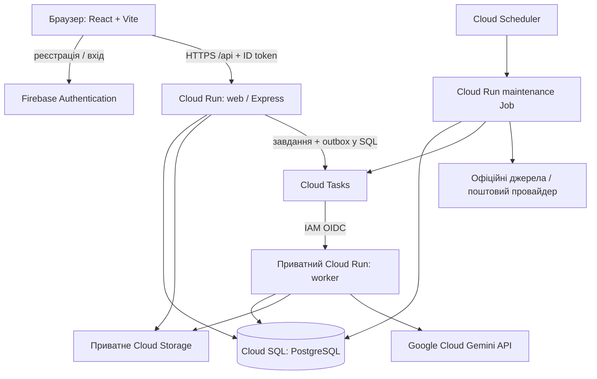

# GrantFolio: архітектура Google Cloud

Дата: 12 листопада 2026. Статус: поточний технічний план, **ще не реалізовано**. Вибір Google Cloud підтверджений користувачем; конкретні налаштування нижче — рекомендації до перевірки під час реалізації. [Фактичний стан](STATUS.md) · [Рішення](DECISIONS.md) · [План задач](BACKLOG.md)

## Продуктовий сценарій і межі

Реєстрація → опис бізнесу → підтверджений профіль → каталог з офіційними джерелами й поясненням відповідності → справа однієї підтримуваної програми → документ і підтвердження прочитаних значень → бюджет і чернетка тексту → зміна ціни → перевірений експорт → повернення до збереженої справи.

Перша програма й її форма ще не обрані. Повний пакет підтримуємо для цієї програми; каталог може бути ширшим. На сторінці кожної можливості показуємо обсяг підтримки, джерело й час перевірки. Формат експорту визначає офіційна форма, а не зручність PDF-генератора. Підпис і подання виконує користувач.

Обов'язкові результати до 19.11: структура репозиторію й коректний README, HTTPS sign-up/sign-in, реальні користувачі та PDF із відгуками/змінами. Повний [текст завдання](assignment.md) має пріоритет над архітектурними прикладами курсу. OOAD використано як рекомендації.

## Склад системи



Одна TypeScript кодова база, один Docker image з різними командами запуску. Публічний `web` обслуговує зібраний frontend і `/api` на одному HTTPS-origin. `worker` приймає тільки приватні task-запити. `maintenance` — скінченна команда перевірки джерел і відновлення черги; `migrate` — одноразовий запуск міграцій. Це різні процеси спільного застосунку. Kubernetes і окремі мікросервіси для кожної бізнес-сутності не потрібні.

| Частина | Технологія | Відповідальність |
|---|---|---|
| Інтерфейс | React, Vite, TypeScript | Чат, каталог, справи, профіль; стан довгих операцій |
| Сервер | Node.js, Express, TypeScript | Авторизація, сценарії, валідація, розрахунки, API |
| Вхід | Firebase Authentication + Admin SDK | Email/password, відновлення пароля, перевірка токенів |
| Дані | Cloud SQL PostgreSQL, серверний pg pool | Факти, справи, версії, бюджет, операції й outbox |
| Файли | Приватне Cloud Storage | Оригінали, проміжні результати, експорти |
| Тривалі роботи | Cloud Tasks + private Cloud Run worker | AI, витягування даних, побудова експорту |
| Розклад | Cloud Scheduler + Cloud Run Job | Підключені джерела, відправлення листів, recovery |
| ШІ | Серверний Google Gen AI adapter | Контекст, текстові пропозиції, структурований витяг |
| Експлуатація | Secret Manager, Artifact Registry, Cloud Logging | Секрети, образи й діагностика |
| Збірка/deploy | GitHub Actions + Workload Identity Federation | Перевірки, образ, міграції, release |

Початково пропонуємо `europe-west1` для застосунку/SQL/Tasks за умови доступності. Для Gemini endpoint і SFT location перевіряються окремо. Європейський Cloud Run сам по собі не доводить європейське розміщення всіх даних.

## Код і межі модулів

```text
backend/src/
  entrypoints/       web, worker, maintenance, migrate
  modules/
    business/        підтверджений профіль і його версії
    grants/          джерела, програми, раунди, умови й відповідність
    applications/    справа, документи, бюджет, чернетки, експорт
    assistant/       розмова, контекст, пропозиції змін
    notifications/   підписки, відписка, доставка
  platform/          DB, identity, storage, AI, queue, config
frontend/src/        екрани та API client
infra/              відтворювані налаштування Google Cloud і deploy
```

У feature-модулі — тонкий HTTP handler, сценарії/правила, порти та PostgreSQL adapter. HTTP, SQL і cloud SDK не потрапляють у бюджетні формули. Інші модулі використовують публічний контракт модуля, а не його repository чи прямі SQL-запити. `applications` володіє станом, який потрібно атомарно узгоджувати: бюджетом, версіями, чернетками й експортом. Не створюємо універсальний repository на кожну таблицю заради схеми.

Версії Node, бібліотек, PostgreSQL і інструмента міграцій фіксуємо під час створення коду після перевірки сумісності. Тоді ж додаємо lockfile, фактичні команди запуску й тести. Нинішні каталоги містять лише описи.

## Вхід і доступ до даних

Клієнт реєструє/авторизує користувача через Firebase SDK і передає ID token серверу. Admin SDK перевіряє підпис, issuer, audience і строк токена; сервер формує Actor із перевіреного `uid`. UID — **TEXT**, не PostgreSQL UUID. Сервер не приймає `owner_id` як довірене поле від клієнта. [Firebase: перевірка ID tokens](https://firebase.google.com/docs/auth/admin/verify-id-tokens).

Приватні запити містять умову власника; доступ до дочірнього документа перевіряє власника справи. Неприсутній і чужий приватний ресурс повертають 404. У worker власник береться зі збереженого SQL job, а не з довільного task body. Браузер не має SQL-облікових даних. Початкова схема не потребує власного шару RLS; додаємо його лише за конкретної потреби з окремими тестами.

Firebase SDK керує збереженням/оновленням сесії. Перевіряємо reload, logout, прострочений токен і відновлення пароля. Для email/password окремий Google OAuth callback не потрібний. Налаштовуємо дозволені домени та action links. Політику підтвердження email перед upload/AI визначаємо до публічного тесту й перевіряємо доставку. [Firebase email/password](https://firebase.google.com/docs/auth/web/password-auth).

Публічна Cloud Run сторінка входу не відкриває приватні API. Сервіс worker має окремий entrypoint і IAM-захист; його маршрутів немає в public web. Токен користувача Firebase й IAM token сервісу — окремі механізми. [Cloud Run service-to-service](https://docs.cloud.google.com/run/docs/authenticating/service-to-service).

## Дані, джерела та версії

| Дані | Ключова домовленість |
|---|---|
| Профіль бізнесу | owner_id, підтверджені значення, revision; unknown відрізняється від нуля |
| Програма/раунд/джерело | Окремі раунди, URL, checked_at, версія умов, статус перевірки |
| Справа | Власник, знімки профілю/умов, revision, стан готовності |
| Документ | Власна справа, private object key, checksum, стан обробки, сторінка/фрагмент для знайденого факту |
| Бюджет | Точні minor units/decimal, кількість, валюта, підтверджені припущення й джерело |
| Пропозиція/чернетка | Вихідні revision, текст/patch, джерела, підтвердження користувача |
| Експорт | Незмінний знімок тексту/фактів/бюджету/версії умов і збережений файл |
| Job/outbox | Власник, тип, input snapshot, ключ повтору, статус, спроби, lease, результат/помилка |
| Підписки/відгуки | Налаштування й фактичний запис, без вигаданих результатів |

Підтверджений факт, припущення користувача й припущення моделі зберігаються з різним статусом. Витягування з документа створює пропозицію з посиланням на сторінку; підтвердження змінює факти. Оновлення профілю не переписує мовчки вже подану справу. Критерії гранту дають «відповідає / не відповідає / бракує даних», а не вигаданий точний відсоток успіху.

## Зміна ціни та експорт

Команда зміни бюджету містить `expectedRevision` і ключ повтору. Одна DB-транзакція перевіряє власника/revision, застосовує підтверджену зміну, викликає єдину TypeScript-функцію розрахунку, зберігає нову revision та результат команди. Конкурентна стара зміна отримує 409. Формули не дублюємо в SQL, frontend і prompt.

Чернетка актуальна лише для тих revision, на яких її створили. Після зміни ціни UI показує потрібні оновлення. AI пропонує переформулювання, користувач підтверджує їх. Старі версії залишаються доступними.

Запит експорту атомарно фіксує знімок справи, створює job і outbox, повертає 202/job ID. Worker будує потрібні формати зі знімка. Зміна справи під час генерації робить цей результат історичним, а не непомітно «актуальним». Мережеві/model/PDF операції відбуваються поза DB-транзакцією.

## Черга і відновлення

Після commit dispatcher створює Cloud Task з іменем, похідним від job ID. Якщо відправлення не вдалося, outbox лишається pending; maintenance повторює його. Успіх queue API без запису dispatch у DB також має оброблятися без повторної зміни справи. SQL job state є джерелом істини, а тимчасова дедуплікація Tasks — допоміжна.

Worker атомарно бере lease з fencing token; лише поточний виконавець може записати результат. Повтор завершеного job повертає успіх без повторної мутації. Recovery знаходить прострочені lease. Окремо фіксуємо спроби модельного виклику: загублена відповідь після прийняття провайдером може спричинити повторну оплату, тому гарантію exactly-once для зовнішнього API не обіцяємо.

Tasks викликає private worker через OIDC service account з Run Invoker. HTTP task має обмежений deadline, максимум 30 хвилин; початково плануємо роботи до 10 хвилин із коротшими provider timeouts і обмеженими файлами. Не продовжуємо дорогу роботу в невичікуваній Promise після HTTP-відповіді. [Cloud Tasks із Run](https://docs.cloud.google.com/run/docs/triggering/using-tasks), [HTTP task setup](https://docs.cloud.google.com/tasks/docs/creating-http-target-tasks).

Maintenance запускається Scheduler через Run Jobs API з OAuth. Спільний job періодично відновлює dispatch, обробляє due-джерела й доставку; locks/checkpoints обмежують дублювання. [Run Jobs за розкладом](https://docs.cloud.google.com/run/docs/execute/jobs-on-schedule).

## Файли, ШІ, моніторинг і пошта

На старті обмежені за розміром upload/download проходять через авторизований API в private bucket. Перевіряємо власну справу, MIME, розмір і checksum. Публічних bucket objects немає; оригінали не зберігаються на диску контейнера. Прямі signed URLs додаємо за потреби після тієї самої перевірки доступу. [Storage public access prevention](https://docs.cloud.google.com/storage/docs/public-access-prevention).

AI adapter працює лише на сервері. Він отримує потрібні підтверджені факти, поточні фрагменти умов і явні unknown, повертає перевірюваний результат. Текст завантажених документів не може давати асистенту нові права чи наказувати виконати дії. Довільний код/SQL від моделі не виконується. Бюджет, правила відповідності й доступ контролює код. Для першого малого каталогу достатньо вибірки потрібних фрагментів з SQL; vector database не потрібна без виміряної потреби.

Кандидат моделі, джерела й навчання: [дослідження](ai-model-research.md), [план SFT](ai-training-plan.md). Навчальних матеріалів немає; поки модель не навчена.

Моніторинг починається з 1–2 дозволених джерел. Зберігаємо URL/час/checksum, розрізняємо раунди, усуваємо дублікати; непевні зміни потрапляють на перевірку. «24/7» означає розклад без відкритого браузера, а не повне миттєве покриття всіх грантів. Для листів потрібен окремо обраний транзакційний провайдер, перевірений відправник і відписка. Firebase-листи входу не замінюють таку пошту.

## Початкове розгортання і витрати

Пропозиція для невеликої групи тестувальників: web min0/max2, worker min0/max1 із concurrency1, queue concurrency1; невеликі DB pools із запасом для одночасних revision/deploy. Параметри переглядаємо за вимірюванням. PostgreSQL — мала single-zone Cloud SQL Enterprise dev/test instance, без заяви про HA/SLA; точний tier і storage узгоджуємо за кошторисом. SQL оплачується і тоді, коли web масштабувався до нуля. [SQL settings](https://docs.cloud.google.com/sql/docs/postgres/instance-settings), [підключення з Run](https://docs.cloud.google.com/sql/docs/postgres/connect-run).

Secret Manager тримає SQL/email секрети. Окремі runtime service accounts мають тільки потрібні SQL/Storage/Tasks/model права; користувачі входять власними обліковими записами. CI використовує GitHub OIDC/WIF з обмеженням на репозиторій і довірену гілку; JSON-ключі не завантажуються в GitHub. [WIF deployment pipelines](https://docs.cloud.google.com/iam/docs/workload-identity-federation-with-deployment-pipelines).

Pipeline: перевірки → один image digest → одна міграція → web/worker/maintenance з того самого образу → HTTPS smoke. Міграції не запускаються на кожному старті web. Зміни схеми спочатку additive; rollback коду не означає автоматичного downgrade даних. Потрібна сумісність зі старими job payload і in-flight tasks.

Перед створенням ресурсів перевіряємо billing, квоти, конкретні ціни й погоджуємо кошторис. У бюджет включаємо SQL/storage, web/worker/jobs, Tasks/Scheduler, AI, logs/build/email. Alert budget не зупиняє витрати; app quotas і max instances зменшують ризик. Доступність окремих spend caps перевіряємо за послугою/акаунтом. Умови AI-кредитів описані в дослідженні; їх не можна вважати автоматично підтвердженими. [Billing budgets](https://docs.cloud.google.com/billing/docs/how-to/budgets).

## Що перевіряємо під час реалізації

- HTTPS реєстрація/вхід/вихід/reload; чужі справи й файли недоступні; private worker відхиляє публічний запит.
- Формули, unknown/межі правил, повтор команди й конфлікт revision; зміна ціни не залишає старий текст «готовим».
- Відмова dispatch, повтор task, перерваний worker, provider timeout; результат не застосовується двічі.
- Знімок експорту відповідає зафіксованій версії й офіційній формі; відсутні дані позначені.
- AI не вигадує критичних фактів і не змінює підтверджені суми; правила доступу діють незалежно від prompt.
- Чистий clone запускається за README; фактичні відгуки й зміни потрапляють у PDF.

Це план інженерної перевірки, а не додаткові академічні deliverables. Поведінку не вважаємо перевіреною до виконання відповідного сценарію.
