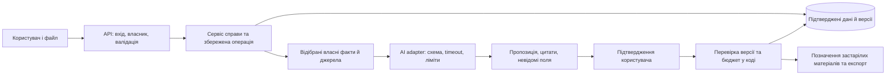

> Історичний агентський звіт. Поточні рішення: [Google Cloud архітектура](../architecture.md) і [DECISIONS](../DECISIONS.md).

# GrantFolio: перевірка ШІ та обробки даних за матеріалами OOAD

Статус: DONE_WITH_CONCERNS. 12 листопада 2026. Прочитано AGENTS.md, INDEX.md та повні тексти відповідних сторінок; команди й вправи лекцій не виконувалися. Це уточнення інженерного плану, а не додаткові вимоги до здачі й не доказ працездатності інтеграцій.

## Висновок

Зберігаємо запропоновані React/Vite/TypeScript, Express/TypeScript і Supabase та один модульний бекенд. Лекції не вимагають замінити їх на FastAPI, AWS чи конкретний агентний фреймворк. Потрібно сильніше зафіксувати межу моделі, версії промптів, підтверджені дані, перевірку результатів та поведінку повільних запитів.

Є суттєве уточнення попередньої рекомендації про синхронну обробку: відповідність довгому HTTP timeout недостатня. Module 6, стор. 5, рекомендує inline лише для короткої відповіді за кілька секунд, streaming для чату, який людина читає, та job для десятків секунд, пакетів і повторів. Module 6, стор. 21, підсумовує це ще категоричніше. Module 5, стор. 31, водночас вимагає обґрунтовувати подію вимірюваною потребою та зберігає простий виклик як початковий варіант.

Тому baseline умовний: короткі операції виконуємо в запиті; чат стрімимо з чесним станом очікування; реальний приклад витягування/генерації перевіряємо на початку розробки. Якщо він регулярно триває десятки секунд, плануємо збережене завдання й виконання поза запитом. У такому разі не можна представляти довге inline виконання як дотримання рекомендації лекції. Якщо команда свідомо залишає його як тимчасове спрощення, це має бути явно зазначено разом із timeout, відновленням і обмеженим розміром файлів. Вимірювання ще не проводилися, отже немає підстав обіцяти конкретну тривалість або безумовно вводити платний always-on worker.

## Межа ШІ та дані

Module 6, стор. 7–9: harness є звичайним програмним забезпеченням навколо моделі; вибір між одним викликом і циклом робиться для окремої функції. Для витягування фактів достатньо одного виклику зі схемою. Для діалогу потрібен невеликий контрольований workflow, а не довільні shell/browser/MCP інструменти. Усі кроки та витрати обмежені.

Module 6, стор. 13: SDK провайдера має бути в одному adapter за власним інтерфейсом. Для GrantFolio це `AIProvider` з власними `AIRequest/AIResult`, конфігурацією провайдера/моделі та централізованими timeout, retry, usage й помилками. Модуль бюджету не імпортує SDK моделі. Fake adapter потрібен для локальних перевірок, але запущене демо не повинно видавати fixture за результат реального ШІ.

Module 6, стор. 14–15: промпти зберігаються в Git як версійовані файли; типізований результат проходить перевірку. До operation додаємо prompt_version, model, input_hash і case_revision. Схема має закриті категорії, посилання на evidence IDs та явні unknown. Некоректний або неповний результат не записується як підтверджений факт. Це однаково застосовується в TypeScript із валідатором схем: Pydantic у слайді є прикладом реалізації, а не обов’язковою бібліотекою.

Підтверджений профіль і поточна версія справи залишаються джерелом даних. Текст чату, резюме розмови й витягнуте моделлю значення не можуть самі переписувати їх. Після підтвердження користувачем зміна ціни атомарно створює нову версію, перераховує бюджет звичайним кодом і робить пов’язані тексти/експорти застарілими. Попередні подані версії зберігаються.

## Retrieval без зайвих систем

Module 6, стор. 19: модель отримує тільки відібрані фрагменти; фільтр власника застосовується до пошуку, а не після відповіді. Цитати потрібні для перевірки користувачем. Слайд показує pgvector, але не доводить потребу в embeddings для маленького каталогу GrantFolio.

Починаємо з SQL-вибірки власних підтверджених фактів, поточної справи й перевірених умов програми за ID. Для однієї підтримуваної програми достатньо потрібних розділів і документів. Посилання на сторінку/комірку/фрагмент зберігаємо як provenance. Семантичний пошук додаємо лише якщо реальні запити неможливо якісно покрити цим відбором; перший кандидат — індекс у наявному Postgres, без окремої vector DB.

Module 8, стор. 62: якість retrieval залежить від чистих пов’язаних даних. Тому офіційне першоджерело, правильний раунд конкурсу, дата перевірки та невідомі умови важливіші за додавання пошуку за схожістю.

## Зовнішній текст не є інструкцією

Module 6, стор. 20: модель може підкоритися тексту документа; її результат є недовіреним input. Для GrantFolio і завантажена пропозиція, і оголошення гранту, і відповідь моделі проходять через обмежені контракти. Документ не може змінити системні правила, дозволи, отримувача листа чи користувача, від імені якого працює інструмент.

Backend визначає користувача з автентифікації, перевіряє власника перед читанням і перед кожною зміною, перевіряє evidence IDs та екранує відображуваний текст. Модель не отримує SQL/shell, довільний URL fetch або можливість надсилати листи. Пропозиція змін виводиться для підтвердження; звичайний endpoint застосовує її з перевіркою очікуваної версії. Секрети, чужі документи й непотрібні особисті дані до промптів не додаються.

За Module 6, стор. 8–9, навіть інструмент із read-only назвою виконується лише з дозволами користувача. Технічно бекенд може мати привілейований SDK, але інструмент не успадковує його необмежений доступ: authority зменшується до перевіреного case/business користувача.

## Повтори, версії й моніторинг

Module 5, стор. 6–8: `GenerateExport` є командою з одним виконавцем, `BudgetUpdated` — фактом, а перегляд стану — query. Не потрібно називати кожну команду подією або вводити pub/sub лише через це розрізнення.

Module 5, стор. 13, 28: in-memory bus/післявідповідні задачі не переживають падіння процесу та самі не дають повторів. Не можна повернути 202 і просто залишити promise в пам’яті, назвавши це надійною фоновою роботою.

Module 5, стор. 19–22: повтори й порушення порядку потрібно очікувати. Для baseline це означає унікальний ключ operation у БД, звірку input hash, однократне застосування ефекту й перевірку case_revision. Повторний запит повертає вже збережений результат. Старий повільний результат не замінює нову версію справи. Операція, перервана перезапуском, має видимий стан interrupted і явну повторну спробу. Ідемпотентність нашої БД не гарантує рівно один оплачений виклик провайдера при невизначеному мережевому результаті.

Якщо знадобляться фонові jobs, повтори, lease/visibility timeout, обмеження спроб і спостереження за failed задачами є частиною цього рішення, а не додатковим косметичним шаром. Не копіюємо значення SQS/Lambda з лекції в конфігурацію іншої платформи.

Module 5, стор. 23–24: якщо опублікування нового раунду має гарантовано поставити листи на відправлення, запис раунду й notification outbox треба робити в одній локальній транзакції. Mail API працює вже після неї, а повтори захищені ключем у БД та, де підтримується, ключем провайдера. Самому раунду потрібен стабільний бізнес-ключ; продовження дедлайну не створює новий конкурс. Module 5, стор. 26: worker/scheduler має власні обмежені повноваження; JWT користувача не зберігається для майбутніх повторів.

Module 8, стор. 11–13, 24–25: для невеликого періодичного моніторингу достатньо extraction -> нормалізація/дедуплікація -> Postgres за розкладом. Потреба в оновленні раз на 30–60 хвилин не вимагає Kafka, Spark чи потокової платформи. Це запропонований інтервал, а не вимога викладача або вже виміряна потреба користувача. Перелік джерел і їхня читабельність залишаються неперевіреними.

## Які перевірки реально потрібні

Module 6, стор. 18: один вдалий показ не доводить якість моделі. Потрібен набір представницьких input із перевірюваними властивостями й сигнали від користувачів. Лекційні числа 20–50/30–50 прикладів і judge model не є критеріями поточної здачі. Не вводимо обов’язкову платну eval-платформу або другий ШІ-суддю.

Початкові перевірки, які покривають реальні ризики нашого сценарію:

- документ із ціною: правильна сума або явне питання; невідомий факт не вигадується;
- неповні умови гранту: unknown із питанням та джерелом;
- зміна ціни: точний перерахунок, застарілі тексти/експорт позначені;
- чужий case/document ID: відмова до читання контексту;
- інструкція всередині PDF: відсутність несанкціонованої дії;
- дубль operation/оголошення: один підтверджений ефект;
- timeout/refusal/неправильний формат: збережений input, зрозуміла помилка, відсутність фіктивного успіху.

Детерміновані правила бюджету, ізоляцію й контракти перевіряємо звичайними тестами. Результати реального провайдера оцінюємо за властивостями, без exact-string порівняння українського тексту. Після вибору моделі й погодження витрат записуємо фактичні latency, tokens, prompt/model version та outcome на репрезентативних зразках. Наразі жодна оплачувана модельна перевірка не запускалася; показники не вигадуються.

Для справжнього user report окремо фіксуємо реальних учасників, фактичні спроби, їхні слова й конкретні зміни. Тести моделі не замінюють вимоги показати продукт людям. Повні приватні документи не потрапляють у публічний звіт або загальні логи; evidence обмежуємо необхідним із контрольованим зберіганням.

## Схема для основного плану

## Прочитані джерела

- `/Users/stashnidyk/Documents/ChatGPT/OOAD/AGENTS.md`, `course-materials/INDEX.md`.
- Module 6, `06-llm-as-part-of-the-solution.md`: стор. 4–9, 13–21, включно з повними незалежними PDF-текстами relevant pages.
- Module 5, `05-event-driven-architecture.md`: стор. 5–8, 13–15, 19–26, 28–31.
- Module 8, `08-big-data-and-data-architecture.md`: стор. 11–13, 24–25, 62–64.

Не заявляється повнота відновлення всіх матеріалів курсу. Для цих висновків не було потреби виконувати код зі слайдів, перевіряти ціни хмарних сервісів із лекції чи запускати вправи.
